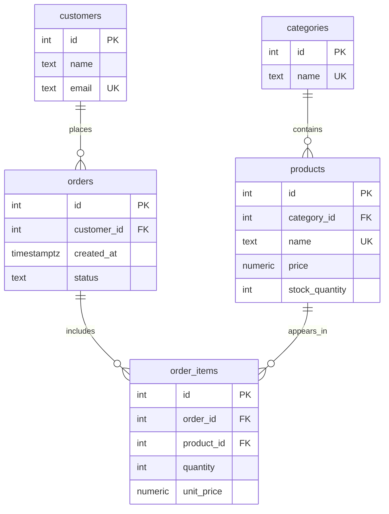

# Интернет магазин

Тема № 5 : **Интернет-магазин**. База данных хранит информацию о товарах, категориях, покупателях и заказах и помогает контролировать состав заказов и остатки товаров.

| | |
| --- | --- |
| Главная таблица | products |
| Связь N:M | orders и products через `order_items` |
| Бизнес-правило | Остаток товара на складе не может быть отрицательным |
| СУБД | PostgreSQL 17 в Docker |

## Задания курса

Правила курса, установка и порядок сдачи: [docs/README.md](docs/README.md).

| Лаба | Задание |
| --- | --- |
| 1. Модель данных и схема | [docs/lab-1.md](docs/lab-1.md) |
| 2. Запросы | [docs/lab-2.md](docs/lab-2.md) |
| 3. Логика в базе | [docs/lab-3.md](docs/lab-3.md) |
| 4. Транзакции и доступ | [docs/lab-4.md](docs/lab-4.md) |
| 5. Производительность | [docs/lab-5.md](docs/lab-5.md) |
| Витрина к защите | [docs/showcase.md](docs/showcase.md) |

## Как запустить

```bash
cp .env.example .env          # пароли и порт
docker compose up -d          # при первом запуске выполняются скрипты из db/
dbcheck run demo/lab1.sql     # сценарий лабы 1
```

Работа с базой: `docker compose exec db psql -U postgres -d app`. Сценарии выполняются в `psql` командой `\i /demo/lab1.sql`.

После изменения скриптов в `db/` базу нужно пересоздать: `docker compose down -v && docker compose up -d`.

## ER-диаграмма


## Нормализация

### Исходная таблица

До нормализации данные интернет-магазина могли бы храниться в одной таблице `order_details_all`, содержащей номер заказа, дату, имя и email покупателя, название товара, категорию, количество и цену.

Если заказ содержит несколько товаров, сведения о заказе и покупателе повторяются в каждой строке. Это приводит к избыточности и аномалиям обновления: при изменении email покупателя пришлось бы исправлять несколько строк.

### Разделение до третьей нормальной формы

- **Первая нормальная форма (1НФ).** В каждой ячейке хранится одно значение, а каждая строка однозначно идентифицируется. Список товаров не хранится в одной ячейке: товары заказа представлены отдельными строками в `order_items`.
- **Вторая нормальная форма (2НФ).** Каждый неключевой атрибут зависит от полного первичного ключа. Сведения о покупателях, товарах и заказах вынесены в отдельные таблицы, а `order_items` хранит данные о конкретном товаре в конкретном заказе.
- **Третья нормальная форма (3НФ).** Неключевые атрибуты зависят от ключа, а не от других неключевых атрибутов. Например, название категории хранится в `categories`, а в `products` хранится только `category_id`. Имя и email покупателя находятся в `customers`, а в `orders` хранится `customer_id`.

### Результат

Данные разделены между таблицами `categories`, `products`, `customers`, `orders` и `order_items`. Первичные и внешние ключи связывают таблицы и обеспечивают ссылочную целостность. Повторение сведений о покупателях, товарах и категориях сокращено.

Таблица `order_items` реализует связь многие-ко-многим (N:M) между заказами и товарами.

## Правила удаления связанных данных

Для каждого внешнего ключа явно задано поведение `ON DELETE`.

| Связь | Поведение | Причина |
|---|---|---|
| `products.category_id → categories.id` | `RESTRICT` | Нельзя удалить категорию, пока в ней есть товары |
| `orders.customer_id → customers.id` | `RESTRICT` | Нельзя удалить покупателя, у которого есть заказы |
| `order_items.order_id → orders.id` | `CASCADE` | При удалении заказа автоматически удаляются его позиции |
| `order_items.product_id → products.id` | `RESTRICT` | Нельзя удалить товар, который используется в позициях заказов |

`RESTRICT` защищает связанные данные от случайного удаления. `CASCADE` применяется к позициям заказа, поскольку без самого заказа они теряют смысл.

Таким образом, база данных сама контролирует поведение удаления и сохраняет ссылочную целостность.

## Генерация тестовых данных

Файл `db/03_generate.sql` создаёт 1000 дополнительных тестовых покупателей с помощью функции PostgreSQL `generate_series(1, 1000)`.

Для каждого покупателя формируются уникальные имя и email. Конструкция `ON CONFLICT (email) DO NOTHING` позволяет повторно запускать скрипт без добавления дубликатов email.

После выполнения скрипта таблица `customers` содержит не менее 1000 тестовых записей. Внешние ключи и ограничения таблицы продолжают действовать.

Для ручного запуска генератора из корня проекта:

```powershell
Get-Content db/03_generate.sql | docker compose exec -T db psql -U postgres -d app
```

Проверить количество покупателей можно командой:

```powershell
docker compose exec db psql -U postgres -d app -c "SELECT COUNT(*) FROM customers;"
```

## Ограничения

| Ограничение | Таблица и колонки | Зачем |
| --- | --- | --- |
| `PRIMARY KEY` | Все таблицы: `id` | Уникально идентифицирует каждую запись |
| `UNIQUE` | `categories.name` | Не допускает одинаковые названия категорий |
| `UNIQUE` | `products.name` | Не допускает одинаковые названия товаров |
| `UNIQUE` | `customers.email` | Не допускает повторную регистрацию с одной почтой |
| `UNIQUE` | `order_items.order_id`, `order_items.product_id` | Не допускает повтор одного товара в одном заказе |
| `CHECK` | `products.price` | Цена должна быть больше нуля |
| `CHECK` | `products.stock_quantity` | Остаток товара не может быть отрицательным |
| `CHECK` | `orders.status` | Статус должен входить в разрешённый список |
| `CHECK` | `order_items.quantity` | Количество товара должно быть положительным |
| `CHECK` | `order_items.unit_price` | Цена в заказе должна быть больше нуля |
| `FOREIGN KEY` | Столбцы `category_id`, `customer_id`, `order_id`, `product_id` | Запрещает ссылки на отсутствующие записи |

## Что сделано по лабам

| Лаба | Что сделано | Сценарий |
| --- | --- | --- |
| 1 | Созданы таблицы, ключи и ограничения; добавлены тестовые данные и сценарий проверки | `demo/lab1.sql` |
| 2 | Написаны запросы в файле demo/lab2.sql | `demo/lab2.sql` |
| 3 | ... | `demo/lab3.sql` |
| 4 | ... | `demo/lab4.sql`, `demo/race.sql`, `demo/race_fixed.sql` |
| 5 | ... | `demo/lab5.sql` |

<!--
  Разделы, которые добавляются по ходу курса:
  лаба 1 ★: «Нормализация», «Типы данных»; ★★: «Что происходит при удалении»;
  лаба 4: «Гонка»;
  лаба 5: «Производительность» (таблица до / после, когда индекс не помогает, размеры).
-->
