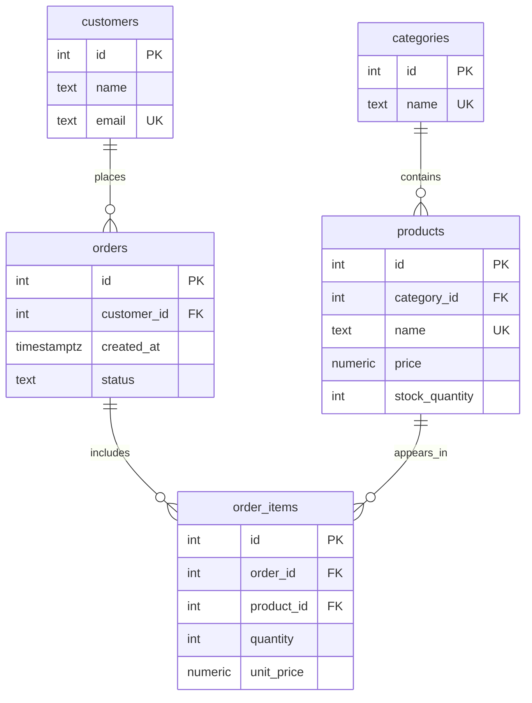

# Интернет магазин

Тема № 5 : **Интернет-магазин**. База данных хранит информацию о товарах, категориях, покупателях и заказах и помогает контролировать состав заказов и остатки товаров.

| | |
| --- | --- |
| Главная таблица | products |
| Связь N:M | orders и products через `order_items` |
| Бизнес-правило | Остаток товара на складе не может быть отрицательным |
| СУБД | PostgreSQL 17 в Docker |

## Задания курса

Правила курса, установка и порядок сдачи: [docs/README.md](docs/README.md).

| Лаба | Задание |
| --- | --- |
| 1. Модель данных и схема | [docs/lab-1.md](docs/lab-1.md) |
| 2. Запросы | [docs/lab-2.md](docs/lab-2.md) |
| 3. Логика в базе | [docs/lab-3.md](docs/lab-3.md) |
| 4. Транзакции и доступ | [docs/lab-4.md](docs/lab-4.md) |
| 5. Производительность | [docs/lab-5.md](docs/lab-5.md) |
| Витрина к защите | [docs/showcase.md](docs/showcase.md) |

## Как запустить

```bash
cp .env.example .env          # пароли и порт
docker compose up -d          # при первом запуске выполняются скрипты из db/
dbcheck run demo/lab1.sql     # сценарий лабы 1
```

Работа с базой: `docker compose exec db psql -U postgres -d app`. Сценарии выполняются в `psql` командой `\i /demo/lab1.sql`.

После изменения скриптов в `db/` базу нужно пересоздать: `docker compose down -v && docker compose up -d`.

## ER-диаграмма




## Ограничения

| Ограничение | Таблица и колонки | Зачем |
| --- | --- | --- |
| `PRIMARY KEY` | Все таблицы: `id` | Уникально идентифицирует каждую запись |
| `UNIQUE` | `categories.name` | Не допускает одинаковые названия категорий |
| `UNIQUE` | `products.name` | Не допускает одинаковые названия товаров |
| `UNIQUE` | `customers.email` | Не допускает повторную регистрацию с одной почтой |
| `UNIQUE` | `order_items.order_id`, `order_items.product_id` | Не допускает повтор одного товара в одном заказе |
| `CHECK` | `products.price` | Цена должна быть больше нуля |
| `CHECK` | `products.stock_quantity` | Остаток товара не может быть отрицательным |
| `CHECK` | `orders.status` | Статус должен входить в разрешённый список |
| `CHECK` | `order_items.quantity` | Количество товара должно быть положительным |
| `CHECK` | `order_items.unit_price` | Цена в заказе должна быть больше нуля |
| `FOREIGN KEY` | Столбцы `category_id`, `customer_id`, `order_id`, `product_id` | Запрещает ссылки на отсутствующие записи |

## Что сделано по лабам

| Лаба | Что сделано | Сценарий |
| --- | --- | --- |
| 1 | Созданы таблицы, ключи и ограничения; добавлены тестовые данные и сценарий проверки | `demo/lab1.sql` |
| 2 | ... | `demo/lab2.sql` |
| 3 | ... | `demo/lab3.sql` |
| 4 | ... | `demo/lab4.sql`, `demo/race.sql`, `demo/race_fixed.sql` |
| 5 | ... | `demo/lab5.sql` |

<!--
  Разделы, которые добавляются по ходу курса:
  лаба 1 ★: «Нормализация», «Типы данных»; ★★: «Что происходит при удалении»;
  лаба 4: «Гонка»;
  лаба 5: «Производительность» (таблица до / после, когда индекс не помогает, размеры).
-->
